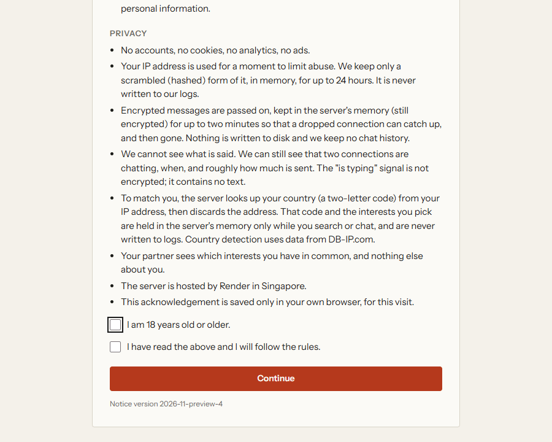
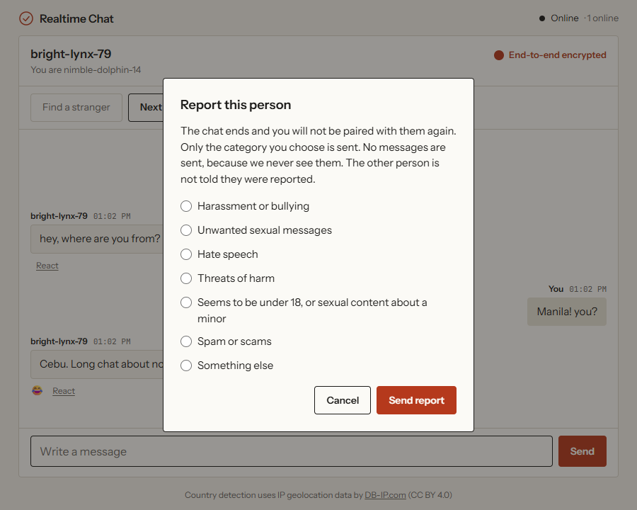
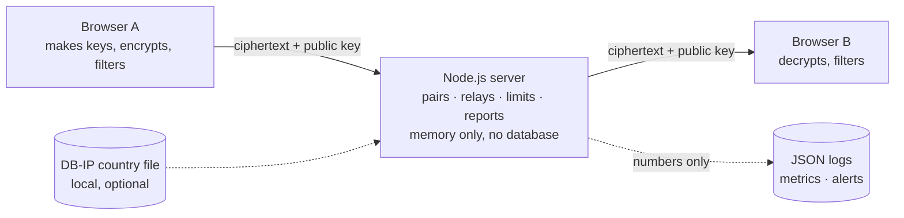

# realtime-chat

**Anonymous one-to-one chat where only the two people can read what they say.** The server pairs strangers, relays encrypted messages it cannot read, and keeps nothing. No accounts, no stored history.

> **A portfolio project.** I built it end to end to show how I work: a TypeScript backend (Express, Socket.IO, zod), end-to-end encryption in the browser with WebCrypto, abuse handling that does not need to read anyone's messages, a hand-designed interface, and the testing and documentation around it. It runs locally, has **never been deployed**, and **no lawyer has reviewed it**, so it is not a service for the public. What is missing and why is written down in [**known limits and future work**](docs/00-overview/limits-and-roadmap.md).



_A recording of the real app (not a mock-up): two separate browsers pair, the chat becomes end-to-end encrypted, messages and a reaction go both ways, and the safety code dialog opens. Re-recorded by `npm run e2e:capture`._

| Gate | Ready (interests, country) | Chat |
|---|---|---|
|  |  |  |

| Safety code | Report | Phone width |
|---|---|---|
|  |  |  |

## What is worth looking at

| | What I built | Where to look |
|---|---|---|
| **End-to-end encryption** | ECDH P-256 key exchange, HKDF, AES-GCM-256 with a separate key per direction, padding, replay and tamper rejection, a safety code to detect a man in the middle. Native WebCrypto only, no hand-made crypto. A browser test inspects **every WebSocket frame** of a real chat and finds none of the words typed | [e2ee.md](docs/04-security/e2ee.md), `public/js/crypto.js` |
| **Privacy by design** | The server is a blind relay with no database. People are told apart only by a **keyed hash of their IP that changes daily**; the raw address is read in one file and a **CI check fails the build** if it is read anywhere else. Logs are scrubbed and tested for leaks | [security-overview.md](docs/04-security/security-overview.md) |
| **Abuse handling without reading chats** | Reports (a category, never text), no-rematch, temporary blocks when three different people report one connection, a content filter on both ends, a bot puzzle (proof of work), rate limits everywhere | [trust-and-safety.md](docs/04-security/trust-and-safety.md) |
| **Matching** | Shared-interest scoring with a timed fallback, and country preference from a local IP database, always satisfying **both** people's wishes | [matchmaking.md](docs/03-design/matchmaking.md) |
| **Testing** | 726 unit and integration tests (real server, real sockets), 40 browser tests with **two real browsers**, axe checks for WCAG 2.1 AA, a **load test** of 200 and 400 simulated people with real encryption | [scaling.md](docs/06-operations/scaling.md) |
| **Observability** | A metrics snapshot every minute, alert rules, a moderator summary of the logs that cannot show messages or addresses | [monitoring-observability.md](docs/06-operations/monitoring-observability.md) |
| **Honest engineering** | A [register of every known limit](docs/00-overview/limits-and-roadmap.md), a [decision log](docs/00-overview/decision-log.md), a [security overview](docs/04-security/security-overview.md) mapping each claim to the test that proves it, and a final [self-audit](docs/10-reviews/2026-11-14-final-audit.md) of the result | `docs/` |

**Defects the tests caught while building it** (each fixed, with a test): a no-rematch rule that would have blocked everyone on a shared network; an empty chat log hidden from screen readers; chat lines that were orphan list items; a gauge that read 30 ms on an idle process; and several races in my own tests.

## How it works



1. The page solves a small puzzle, gets a short-lived token, and opens a WebSocket. The server checks the origin, the token, the protocol version and the 18+ acknowledgement.
2. Search for a stranger, optionally with up to 5 interests and a country preference. Two people are paired and each gets a random name.
3. Each browser makes a fresh key pair and sends only the **public** half through the server. Both derive the same keys and can compare a **safety code** outside the chat.
4. Every message and reaction is encrypted in the browser and relayed as ciphertext. When the chat ends it is gone; the server never had it.

Details: [high-level design](docs/03-design/high-level-design.md) · [protocol (AsyncAPI)](docs/03-design/asyncapi.yaml) · [encryption protocol](docs/04-security/e2ee.md)

## What a user can do
- Pair with one stranger at a time, with a random name, behind an 18+ and rules gate
- Choose up to 5 interests and "anywhere" or "my country only"
- Chat with end-to-end encryption, react to messages, see typing and connection status
- Survive a short network drop (30 s) without losing the chat
- Compare a safety code, report the person, skip to someone new or end the chat
- Use it with a keyboard alone, with reduced motion, down to a 320 px screen

## Tech
| | |
|---|---|
| Server | Node 22, TypeScript (strict), Express 5, Socket.IO, zod, helmet, maxmind. **Five** runtime dependencies |
| Browser | Plain JavaScript and CSS, no framework and no build step; WebCrypto; self-hosted fonts. **84 KB** on the wire |
| Tests | Vitest, socket.io-client, Playwright, axe-core |
| CI | GitHub Actions: typecheck, tests, build, `npm audit`, gitleaks, semgrep, browser tests, size and licence checks |

## Run it
```bash
npm ci
npm run dev        # http://localhost:3000 — open it in TWO browser tabs
```
Accept the gate in both tabs and choose **Find a stranger** in each. A chat needs two people. (`localhost` works for encryption; any other address needs HTTPS.) Guide: [local-development.md](docs/08-guides/local-development.md)

| Command | What it does |
|---|---|
| `npm test` | 726 unit and integration tests against a real server |
| `npm run test:e2e` | 40 browser tests: two real browsers, accessibility, keyboard-only (needs Edge; `E2E_BROWSER=chromium` for Chromium) |
| `npm run load:test` | 200 simulated people chat, end-to-end encrypted ([results](docs/06-operations/scaling.md)) |
| `npm run moderation -- <logfile>` | A moderator's summary of the logs (no messages, no addresses) |
| `npm run e2e:capture` | Re-records the screenshots and demo GIF above |
| `npm run geo:update` | Downloads the country database (optional; needs `COUNTRY_DB_PATH`) |
| `npm run typecheck` · `npm run build` · `npm start` | Types · compile · run the production build |

## Project layout
```
src/            server: gateway (events), sessions, matchmaking, safety (reports, bans),
                security (tokens, hashing, puzzle), observability (logs, metrics, alerts), geo
public/         the page: index.html, styles.css, client.js, js/ (crypto, filter, puzzle), fonts/
tests/          unit/ and integration/ (a real server on a random port)
e2e/            Playwright browser tests, accessibility tests, screenshot and GIF capture
scripts/        load test, moderator summary, country database download
docs/           design, security, operations, compliance, decisions, audit (docs/README.md)
```

## Status
**Milestones M0 to M7 are built and tested.** M8 (public launch), M9 (production hardening) and M10 (post-launch operations) are **deliberately not pursued**: they need hosting, a lawyer, a legal entity and people, which a portfolio project does not have. Their plan is kept in [milestones.md](docs/01-product/milestones.md).

| | |
|---|---|
| Never deployed | No live link. If one is ever added it runs on free hosting and has no moderation |
| Not reviewed by anyone outside | No lawyer, no cryptographer, no penetration test (the [audit](docs/10-reviews/2026-11-14-final-audit.md) is the author's own) |
| Alerts are log lines | Nobody is paged until the service is hosted |
| Age is self-declared | A tick box, by design; real verification would contradict the privacy promise |

Everything else, with reasons and plans: [**known limits and future work**](docs/00-overview/limits-and-roadmap.md). Why things are the way they are: [**decision log**](docs/00-overview/decision-log.md).

## Documentation
| Folder | What's inside |
|---|---|
| [00-overview](docs/00-overview/README.md) | Vision, **decision log**, open decisions, **known limits and roadmap** |
| [01-product](docs/01-product/README.md) | Milestones, user stories, features |
| [02-requirements](docs/02-requirements/README.md) | Requirements and limits |
| [03-design](docs/03-design/README.md) | Architecture, protocol (AsyncAPI), ADRs, per-story designs |
| [04-security](docs/04-security/README.md) | **Security overview**, encryption, trust and safety, threat model, checklist |
| [05-quality](docs/05-quality/README.md) | Testing strategy |
| [06-operations](docs/06-operations/README.md) | Deployment, monitoring, scaling and **load test results**, runbooks |
| [07-process](docs/07-process/README.md) | Workflow, CI/CD |
| [08-guides](docs/08-guides/README.md) | Local development |
| [09-compliance](docs/09-compliance/README.md) | Philippine law, data inventory, policy **drafts**, moderator guide |
| [10-reviews](docs/10-reviews/README.md) | Past reviews and the [final audit](docs/10-reviews/2026-11-14-final-audit.md) |

## Licence
[ISC](LICENSE). The fonts (Instrument Sans, JetBrains Mono) are under the SIL Open Font Licence; their licences are in `public/fonts/`. Country data is from [DB-IP.com](https://db-ip.com) (CC BY 4.0).
