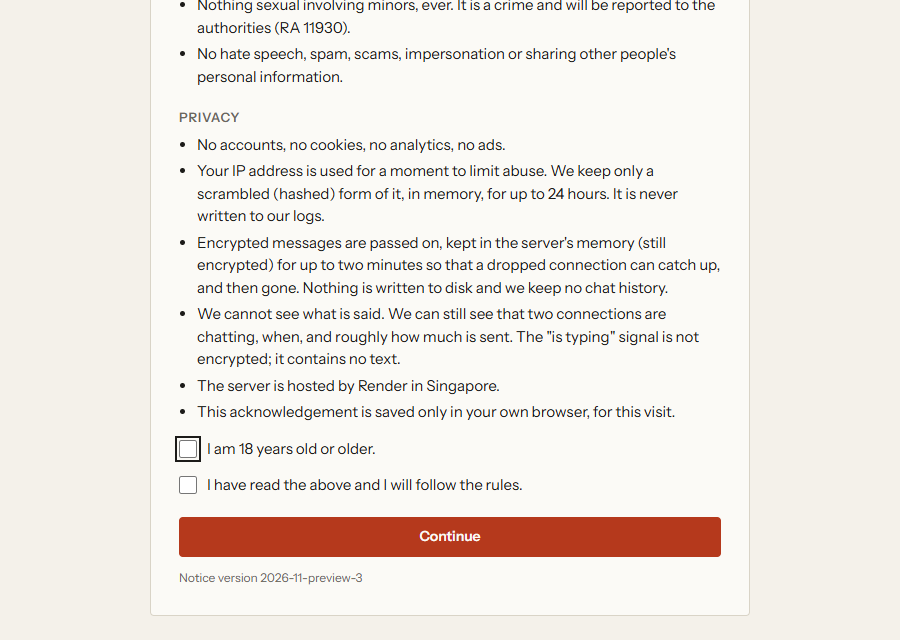
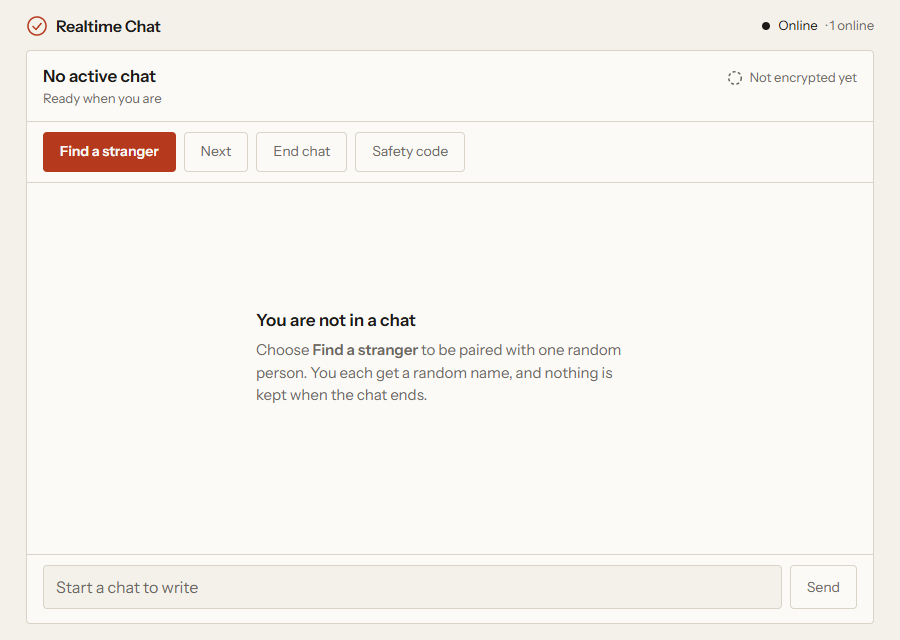
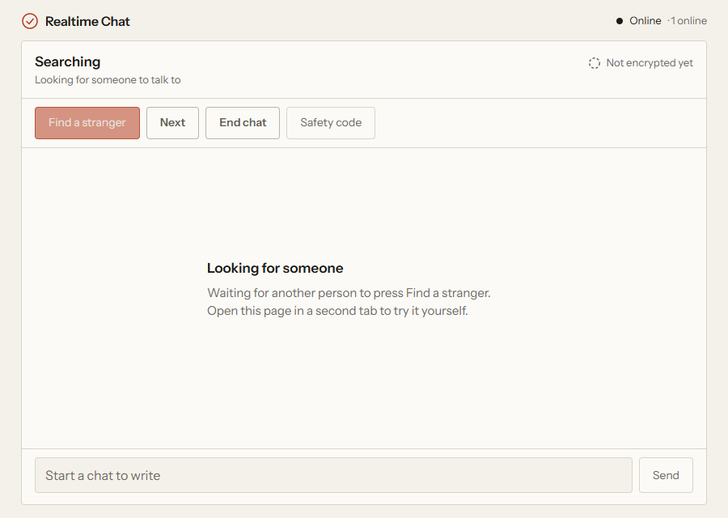
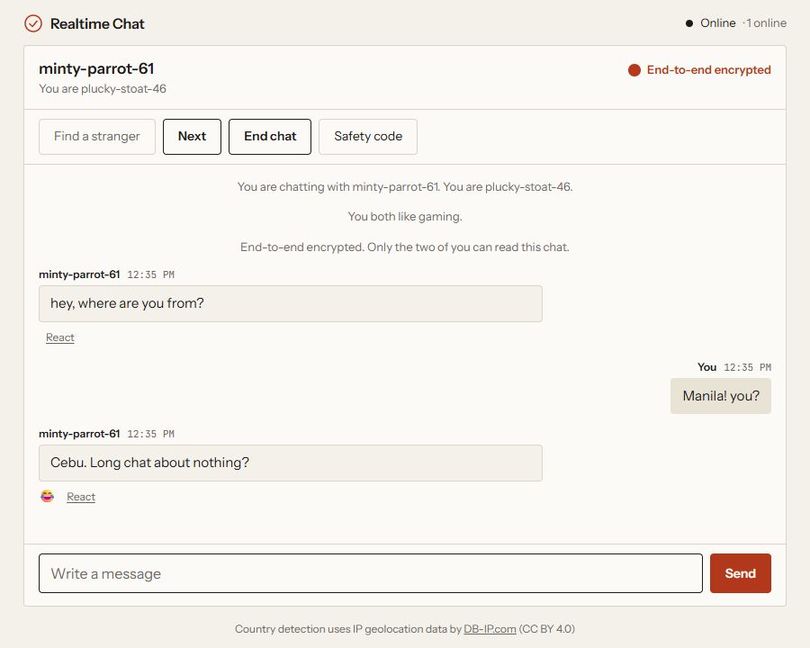
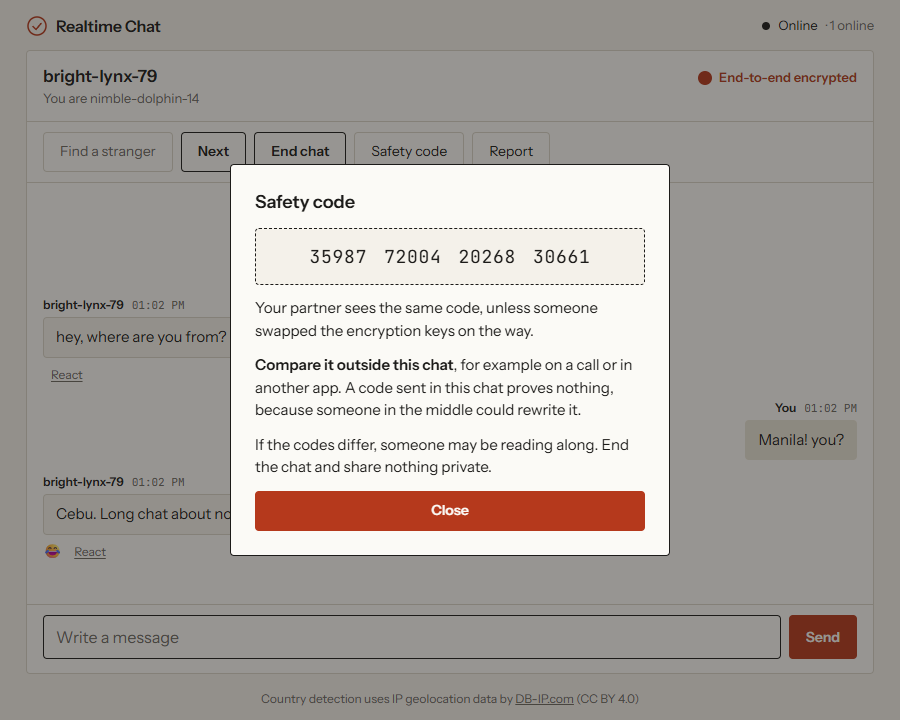
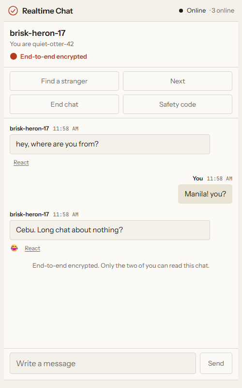
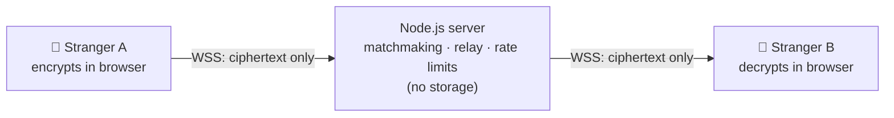

# realtime-chat

**Anonymous, end-to-end encrypted, one-to-one chat that connects strangers around the world by shared interests.**
No accounts. No stored messages. Free to use, safe by design.

> **Mission:** connect people across the world through safe, private, anonymous conversations, on a platform that stays **free**, runs **reliably** and **protects its users**.
> 📚 Full documentation: [**docs/**](docs/README.md) · 🗺️ Plan: [**milestones**](docs/01-product/milestones.md)

> **This is a portfolio project.** I built it to show full-stack work: a TypeScript backend (Express, Socket.IO, zod), browser-side end-to-end encryption with WebCrypto, and a hand-designed interface. It is not a launched product and it is not run as a service for the public.

> ⚠️ **Status: M4 code complete.** The app pairs you with **one stranger** at a time behind an 18+ gate, and messages are **end-to-end encrypted** in the browser. Matchmaking by interest, reporting, moderation and the legal review are still ahead, so it is not ready for public use. Next is **M5: matchmaking**.

---

## Screens

| Gate | Ready | Searching |
|---|---|---|
|  |  |  |

| Chat | Safety code | Phone width |
|---|---|---|
|  |  |  |

_The screenshots show the real interface with a sample conversation: a chat needs two people, so the messages were staged for the picture._

## Try it

Run it locally: `npm ci && npm run dev`, then open `http://localhost:3000` in **two browser tabs** (a chat needs two people), accept the 18+ gate in each, and choose **Find a stranger** in both.

- Both tabs show **End-to-end encrypted**; **Safety code** shows the same code in both.
- In DevTools → Network → WS the frames carry only ciphertext (`e2e:envelope`), never your words.
- Live demo: _none yet_. If one is added it runs on free hosting, so the first load can take up to a minute, and it has no moderation: do not share anything personal.

---

## What it will be (v1)

1. Confirm you're **18+** and accept the rules
2. Optionally pick up to 5 **interests** and choose **my country** or **worldwide**
3. Get a **random name** (e.g. `quiet-otter-42`) and get matched with **one stranger** who shares an interest, or a random stranger after 10 s
4. Chat with **end-to-end encryption**: the server only relays ciphertext it can't read
5. `/next` to meet someone new, `/report` to report abuse. When a chat ends, its messages are **gone forever**

**Safety:** automated behavioral monitoring detects abuse patterns; content filters catch harmful messages before encryption; human moderators review aggregated reports and handle escalations; all designed around Philippine law (Data Privacy Act, Cybercrime Prevention Act, Safe Spaces Act, Anti-OSAEC Law). What each law requires and where we stand: [docs/09-compliance](docs/09-compliance/README.md).

**Never:** accounts, passwords, user-chosen names, group chats, file/image uploads, stored history.

## What works today (M1 to M3)

- **M3, 1:1 chats:** `/start` finds a stranger, you both get random names (`quiet-otter-42`), and messages go only to each other. `/next` skips, `/leave` stops. See when your partner is connected, typing or reconnecting; react with `/react 😂`; see how many people are online (a number, nothing else)
- **M3, survives bad networks:** a dropped connection is held for 30 s and the chat carries on, missed messages included; after that the chat ends for both
- **M3, nothing kept:** the chat exists only in your browser's memory and is wiped when it ends (the server keeps relayed messages in memory for about 100 s so a dropped client can catch up, never on disk)
- Real-time messaging over Socket.IO
- Standard chat interface: conversation panel, message list with reactions, composer, and buttons for Find a stranger, Next, End chat and Safety code. Fonts are self-hosted (Instrument Sans, JetBrains Mono; both OFL)
- Plain-language status for every state (connecting, searching, securing, chatting, offline); keyboard usable; works at 360 px
- Connection status + auto-reconnect; `/health` endpoint; graceful shutdown
- XSS-safe rendering (`textContent`)
- **M2 hardening:** strict zod validation of every event; token-bucket rate limits (5-message burst); 4 KB payload cap; Origin allowlist; short-lived connection token; 5 sockets per IP; security headers + CSP with no inline scripts; 18+ and rules gate enforced by the server; structured JSON logs with no IPs or content; deep `/health`; protocol version `rc/v1`

---

## Architecture

**Target (v1):** the server is a **blind relay**. It matches strangers and forwards encrypted envelopes, and it stores nothing.



Step-by-step request flows: [docs/03-design/high-level-design.md](docs/03-design/high-level-design.md) · Encryption protocol: [docs/04-security/e2ee.md](docs/04-security/e2ee.md)

---

## Project structure (today)

```
realtime-chat/
├── src/                    # Server (TypeScript)
│   ├── index.ts            # Entry: listen on PORT, port-in-use message, graceful shutdown
│   ├── app.ts              # buildServer(): Express + Socket.IO (doesn't listen → testable)
│   ├── config.ts           # Environment variables + limits, validated at startup
│   ├── gateway/            # Connection guards, handler wrapper, registerHandlers (session + chat events)
│   ├── sessions/           # Session state machine, random names, reconnect grace timers
│   ├── matchmaking/        # Simple first-two pairing (replaced by interest matching in M5)
│   ├── http/               # Security headers, /health
│   ├── security/           # Token bucket, client IP, IP hashing, connection token
│   ├── observability/      # JSON logger
│   ├── validation/         # zod schemas
│   └── types/events.ts     # Event contracts, protocol + rules versions
├── public/                 # Frontend (static files)
│   ├── index.html · styles.css · client.js · favicon.svg
│   └── fonts/ · js/crypto.js · js/sessionStore.js   # self-hosted fonts; E2EE; in-memory chat history
├── tests/                  # unit/ and integration/ (real server on a random port)
├── docs/                   # Specs, design, security, operations, process, compliance → docs/README.md
├── .github/                # CI workflow, CODEOWNERS, Dependabot, PR + issue templates
├── render.yaml             # Production service as code (Render Blueprint)
├── package.json · package-lock.json · tsconfig.json · .gitignore
└── README.md
```
Target module layout: [docs/03-design/low-level-design.md](docs/03-design/low-level-design.md#1-module-layout-target-reviewed-for-the-11-e2ee-design)

---

## Dependencies

| Package | Purpose | Status |
|---|---|---|
| `express` | HTTP server, static files, `/health` | ✅ used |
| `socket.io` | Real-time events, reconnection, connection state recovery | ✅ used |
| `zod` | Runtime validation of every incoming event and of the environment ([why](docs/03-design/validation-zod.md)) | ✅ used |
| `helmet` | Security headers + CSP | ✅ used |
| `better-sqlite3` | ~~Message history~~ | ❌ removed: no message storage ([ADR-0005](docs/03-design/adr/0005-no-server-side-message-storage.md), D-05) |

**Dev:** `typescript`, `tsx`, `vitest`, `@types/node`, `@types/express`, `socket.io-client` (integration tests).
Encryption uses the browser's built-in **WebCrypto**, with no crypto library. List installed versions with `npm ls --depth=0`.

---

## Run it locally

```bash
npm ci
npm run dev      # http://localhost:3000 (open 2+ tabs)
```
Full guide (Codespaces, your own computer, phone testing, common problems): [docs/08-guides/local-development.md](docs/08-guides/local-development.md)

| Command | What it does |
|---|---|
| `npm run dev` | Development server with auto-restart |
| `npm run build` / `npm start` | Compile to `dist/` / run like production |
| `npm run typecheck` | TypeScript checks |
| `npm test` / `npm run test:watch` | Tests once / on every save |

Environment variables: [docs/06-operations/deployment.md](docs/06-operations/deployment.md#environment-variables)

---

## Project status & plans

| Milestone | Goal | Effort | Status |
|---|---|---|---|
| M0 Foundations | Scaffold, TypeScript, scripts | — | ✅ |
| M1 Walking skeleton | Two tabs chat; terminal UI + themes | — | ✅ |
| **M2 Hardening + CI/CD + first deploy** | zod, rate limits, headers/CSP, Origin check, connection auth, structured logging, deep health check, protocol versioning, CI, Render CD | 4–5 d | 🚧 code complete; deploy pending |
| **M3 1:1 anonymous sessions** | Random names, pairs of two, `/next` `/leave`, status, typing, reactions, edge case resilience | 4–5 d | 🚧 code complete; deploy pending |
| M4 End-to-end encryption | ECDH + AES-GCM in the browser; `/verify` safety code; key exchange timeout | 4–5 d | 🚧 code complete; deploy pending |
| M5 Matchmaking | Interests, my country / worldwide, fallback | 3 d | 🔜 |
| M6 Trust & safety | 18+ gate, rules, `/report`, temp bans, content filters, PoW bot prevention, legal drafts | 4–5 d | 🔜 |
| M7 Quality, monitoring & moderation | SLIs/SLOs, metrics, alerting, a11y, incident response, moderator tools, load test | 3–4 d | 🔜 |
| M8 Public launch | Legal sign-off, compliance 100%, PH beta launch | 2–3 d | 🔜 |
| M9 Production hardening | Pen test, DR drill, performance baseline, chaos testing | 3–4 d | 🔜 |
| M10 Post-launch operations | Incident response drill, on-call, operational maturity | 2–3 d | 🔜 |

Details, stories and exit criteria: [docs/01-product/milestones.md](docs/01-product/milestones.md) · Open decisions: [docs/00-overview/open-decisions.md](docs/00-overview/open-decisions.md)

### After v1
Multi-language UI · multi-instance scaling with Redis · more regions · installable PWA · X25519 migration · CDN · custom domain · browser fingerprinting. See [scaling.md](docs/06-operations/scaling.md).

---

## Documentation

| Folder | What's inside |
|---|---|
| [00-overview](docs/00-overview/README.md) | Vision, goals, non-goals, open decisions |
| [01-product](docs/01-product/README.md) | Milestones, user stories, features, slash commands |
| [02-requirements](docs/02-requirements/README.md) | Functional + non-functional requirements, limits |
| [03-design](docs/03-design/README.md) | HLD, LLD, matchmaking, zod validation, API versioning, ADRs, per-story technical designs (TDDs) |
| [04-security](docs/04-security/README.md) | E2EE, privacy & sessions (incl. why no JWT), trust & safety, automated monitoring, human moderation, threat model, checklist |
| [05-quality](docs/05-quality/README.md) | Testing strategy, testing requirements |
| [06-operations](docs/06-operations/README.md) | Render, deployment, deployment security, health checks, monitoring, incident response, disaster recovery, scaling, runbook |
| [07-process](docs/07-process/README.md) | Workflows, CI/CD, automation, security tooling, templates, and the full story [pipeline](docs/07-process/pipeline/README.md) (DoR/DoD, classification, hotfixes) |
| [08-guides](docs/08-guides/README.md) | Local development |
| [09-compliance](docs/09-compliance/README.md) | **Philippine law, data privacy and ICT deployment:** regulatory register, compliance matrix, data inventory, privacy impact assessment, breach, police-request and child-safety procedures |
| [10-reviews](docs/10-reviews/README.md) | Archive of past reviews (legal brief, IT manager, DICT-style). Not current guidance |
| [GLOSSARY](docs/GLOSSARY.md) | Every term and acronym |

---

## Timeline

| Date (UTC+8) | Milestone |
|---|---|
| 2026-10-08 | **M0:** project scaffold |
| 2026-10-08 | **M1:** Express + Socket.IO chat, terminal UI, 4 themes |
| 2026-10-08 | **Docs v1:** specs, design, security, process |
| 2026-10-08 | **Docs v2:** product redefined: anonymous 1:1, E2EE, interest/country matching, global reach |

Exact commit times: `git log --date=iso --pretty="%h %ad %s"`
