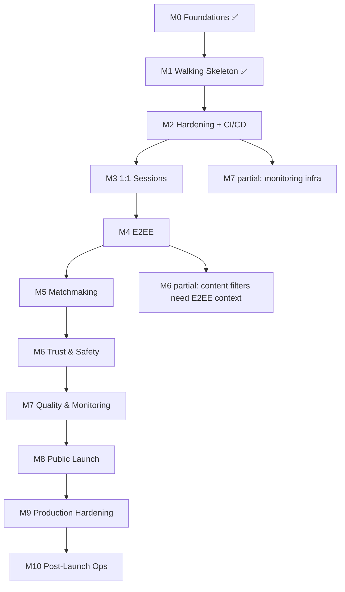

# M-Pipeline: Milestone Lifecycle

The M-Pipeline governs milestone-level planning, execution, and release. It wraps the S-Pipeline — each milestone runs N stories through the S-Pipeline in sequence.

```
 M-PIPELINE
 ═══════════════════════════════════════════════════════════════════════
  M-PLAN        M-DoR        STORIES         M-DoD        M-RELEASE
  ┌──────┐      ┌──────┐     ┌──────┐        ┌──────┐     ┌──────┐
  │seq   │ ──▶  │gate  │ ──▶ │S-Pipe│ × N ──▶│gate  │ ──▶ │tag   │
  │order │      │ready │     │per   │        │release│     │deploy│
  │deps  │      │env   │     │story │        │demo  │     │retro │
  └──────┘      └──────┘     └──────┘        └──────┘     └──────┘
 ═══════════════════════════════════════════════════════════════════════
```

---

## Phase 1: Milestone Planning (M-PLAN)

**Purpose:** Sequence stories, identify dependencies, and set the milestone profile.

### Inputs
- Milestone definition from [milestones.md](../01-product/milestones.md)
- Story classifications from [story-classification.md](story-classification.md)
- Open gaps from [GAPS.md](../tdd/GAPS.md)

### Planning Checklist

| # | Check | Output |
|---|---|---|
| 1 | List all stories in the milestone | Story manifest |
| 2 | Identify inter-story dependencies | Dependency graph |
| 3 | Sequence stories (dependencies first) | Ordered story queue |
| 4 | Identify external dependencies (packages, services, legal) | Dependency register |
| 5 | Calculate milestone profile (% gated vs continuous) | Milestone profile |
| 6 | Estimate total effort | Effort estimate |
| 7 | Identify risk stories (CRITICAL classification) | Risk register |

### Story Sequencing Rules

1. **Dependencies first** — if US-22 depends on US-21, US-21 runs first
2. **CRITICAL stories early** — get the hardest reviews done while fresh
3. **Foundation before features** — infrastructure stories (auth, logging) before feature stories
4. **Parallel-safe stories together** — stories that touch different modules can overlap

### Milestone Profile Example (M2)

```
M2 — Hardening + CI/CD + First Deploy
══════════════════════════════════════
Stories: 8 (1 CRITICAL, 6 HIGH, 1 MEDIUM)
Gated: 7/8 (88%)
Estimated effort: 4-5 focused days
Risk stories: US-32 (connection auth)

Sequence:
  1. US-24 (CD pipeline — MEDIUM, sets up infrastructure)
  2. US-21 (zod validation — HIGH, foundation for all input)
  3. US-22 (rate limiting — HIGH, depends on nothing)
  4. US-23 (security headers — HIGH, depends on nothing)
  5. US-33 (structured logging — HIGH, foundation for observability)
  6. US-34 (deep health — HIGH, depends on US-33 for log format)
  7. US-35 (protocol versioning — HIGH, depends on US-32 handshake)
  8. US-32 (connection auth — CRITICAL, depends on US-21 for validation)
```

---

## Phase 2: Milestone DoR (M-DoR)

**Purpose:** Verify the milestone can be started — environment, dependencies, and prior milestones are complete.

### M-DoR Checklist

| # | Check | How | Blocks |
|---|---|---|---|
| 1 | Prior milestone completed | All prior milestone stories on main | Yes |
| 2 | Prior milestone DoD passed | M-DoD report exists for prior milestone | Yes |
| 3 | All milestone stories have TDDs | Check `docs/tdd/` | Yes |
| 4 | All milestone gaps resolved | `GAPS.md` entries for this milestone | Yes |
| 5 | External dependencies available | Packages installable, services reachable | Yes |
| 6 | Environment ready | Node version, npm ci, typecheck, tests all pass | Yes |
| 7 | Story sequence approved | Sequencing reviewed | Yes |

### M-DoR Output

```json
{
  "milestone": "M2",
  "timestamp": "2026-10-28T09:00:00Z",
  "stories": ["US-24", "US-21", "US-22", "US-23", "US-33", "US-34", "US-35", "US-32"],
  "profile": { "critical": 1, "high": 6, "medium": 1, "gated": 7, "continuous": 1 },
  "checks": {
    "priorMilestoneComplete": { "status": "pass", "milestone": "M1" },
    "allTddsExist": { "status": "pass" },
    "allGapsResolved": { "status": "pass" },
    "externalDeps": { "status": "pass" },
    "environment": { "status": "pass" },
    "sequenceApproved": { "status": "pass" }
  },
  "overall": "pass"
}
```

---

## Phase 3: Story Execution

Each story in the sequence runs through the full [S-Pipeline](story-lifecycle.md):

```
 Story Queue:  US-24 → US-21 → US-22 → US-23 → US-33 → US-34 → US-35 → US-32
                 │
                 ▼
             ┌────────────────────────────────────────┐
             │  S-Pipeline for US-24                  │
             │  DoR → Build → DoD → Merge             │
             └────────────────────┬───────────────────┘
                                  │ ✅ merged to main
                                  ▼
             ┌────────────────────────────────────────┐
             │  S-Pipeline for US-21                  │
             │  DoR → Build → DoD → Merge             │
             └────────────────────┬───────────────────┘
                                  │ ✅ merged to main
                                  ▼
                               ...continue...
```

### Parallel Execution (when safe)

Stories that touch **different modules** and have **no dependency** can run in parallel on separate branches:

```
 Parallel-safe:
   US-22 (rate limiting)  ──────────▶ merge
   US-23 (security headers) ────────▶ merge    (different modules, no dependency)

 Not parallel-safe:
   US-33 (logging) ──▶ US-34 (health check)    (US-34 depends on US-33's log format)
```

### Story Failure Handling

| Situation | Action |
|---|---|
| Story DoR fails | Fix blocker before starting the story; other independent stories may continue |
| Story build fails repeatedly | Escalate to IT Manager; may resequence remaining stories |
| Story DoD fails 3 times | Escalate to IT Manager; story is blocked |
| Story merge breaks main | **Revert immediately**; this becomes a hotfix (H-Pipeline) |

---

## Phase 4: Milestone DoD (M-DoD)

**Purpose:** Verify the milestone is complete — all stories merged, exit criteria met, system is demoable.

### M-DoD Checklist

| # | Check | How |
|---|---|---|
| 1 | All milestone stories merged to main | `git log` verification |
| 2 | All story DoD reports exist and pass | Check `testresults/dod/` |
| 3 | All milestone exit criteria checked | [milestones.md](../01-product/milestones.md) checklist |
| 4 | CI green on main | GitHub Actions |
| 5 | Deployed to Render | Health check passes |
| 6 | Release smoke test passed | Manual test on live URL (phone + laptop) |
| 7 | Threat model updated | New threats from this milestone addressed |
| 8 | Security checklist updated | New items checked |
| 9 | Docs updated | Features, specs, LLD, README |
| 10 | Demo script performed | End-to-end on live URL |
| 11 | Retro note added | Bottom of milestones.md |

### M-DoD Output

```json
{
  "milestone": "M2",
  "timestamp": "2026-11-02T18:00:00Z",
  "stories": {
    "US-24": { "status": "merged", "dod": "pass", "sha": "abc1234" },
    "US-21": { "status": "merged", "dod": "pass", "sha": "def5678" },
    "US-22": { "status": "merged", "dod": "pass", "sha": "ghi9012" },
    "US-23": { "status": "merged", "dod": "pass", "sha": "jkl3456" },
    "US-33": { "status": "merged", "dod": "pass", "sha": "mno7890" },
    "US-34": { "status": "merged", "dod": "pass", "sha": "pqr1234" },
    "US-35": { "status": "merged", "dod": "pass", "sha": "stu5678" },
    "US-32": { "status": "merged", "dod": "pass", "sha": "vwx9012" }
  },
  "exitCriteria": "all_checked",
  "ciGreen": true,
  "deployed": true,
  "smokeTest": "pass",
  "demo": "pass",
  "overall": "pass"
}
```

---

## Phase 5: Milestone Release

**Purpose:** Tag the release and close out the milestone.

### Release Steps

1. Tag the release: `git tag -a M2-complete -m "Milestone M2: Hardening + CI/CD + First Deploy"`
2. Update milestone status in milestones.md: 🔜 → ✅
3. Update README milestone table
4. Add retro note to milestones.md
5. Archive milestone plan in docs/plans/
6. Announce completion

---

## Milestone Dependency Graph



Note: M6 and M7 have partial dependencies — some stories can start earlier, but the milestone as a whole gates on the prior milestone's completion.
